# reviewbot

An AI pull request reviewer. Install it as a **GitHub App** and it leaves inline comments (with one-click
*Commit suggestion* fixes) on every PR, or run it as a **local CLI** to review your diff before you push.
Powered by Google Gemini, so it runs on the free tier.

<!-- TODO: replace with a GIF of the bot commenting on a real PR -->
<!--  -->

## Why it's not another "paste code into an LLM" demo

| Problem with naive AI reviewers | What reviewbot does |
|---|---|
| Comments on lines GitHub rejects | Parses diff hunks and only attaches to valid lines, snapping near misses ([`diffparse.py`](src/reviewbot/diffparse.py)) |
| Noisy, low-value nitpicks | Confidence threshold, severity filter (nits off by default), hard comment cap |
| False positives | Two-pass review: a second "skeptic" call must confirm each finding |
| Repeats itself on every push | Hidden fingerprints in comments; findings already posted are never re-posted |
| Prompt injection via the diff | Diff and PR text are treated as data; the model has no tools to act on them |
| Free-tier rate limits | Client-side throttle, exponential backoff, sequential file review |
| "Trust me, it works" | [`eval/`](eval) scores precision and recall on labeled cases |

## How it works

```mermaid
flowchart LR
    A[PR opened / pushed] --> B[GitHub webhook]
    B --> C[FastAPI: verify HMAC signature]
    C --> D[Background task]
    D --> E[Fetch changed files + .reviewbot.yml]
    E --> F[Filter noise: lockfiles, huge diffs]
    F --> G[Gemini: structured findings per file]
    G --> H[Map to valid diff lines]
    H --> I[Skeptic pass + confidence filter + dedupe]
    I --> J[One review with inline comments]
```



## Quick start (CLI, no GitHub App needed)

```bash
git clone <your-repo-url> && cd Diffsage
python -m venv .venv && source .venv/bin/activate
pip install -e ".[dev]"
cp .env.example .env            # add GEMINI_API_KEY from https://aistudio.google.com/apikey
# .env is loaded automatically (works the same on Windows, macOS and Linux)

cd /path/to/any/git/repo
reviewbot review --base main
```

## Run it as a GitHub App

1. GitHub → Settings → Developer settings → **GitHub Apps → New GitHub App**.
2. Permissions: **Pull requests: Read & write**, **Contents: Read-only**, **Metadata: Read-only**.
3. Subscribe to the **Pull request** event. Set a webhook secret and generate a private key (`.pem`).
4. Put `GITHUB_APP_ID`, `GITHUB_WEBHOOK_SECRET`, `GITHUB_PRIVATE_KEY_PATH` and `GEMINI_API_KEY` in `.env`.
5. Start the server and expose it:

```bash
uvicorn reviewbot.app:app --port 8000
npx smee-client --url https://smee.io/<your-channel> --target http://localhost:8000/webhook   # local dev
```

6. Set the app's webhook URL to your smee channel (dev) or deployed URL (prod), install the app on a repo, open a PR.

Deploy anywhere that runs a container or Python process (Fly.io, Railway, Render, Cloud Run). The webhook
returns immediately and reviews run in the background, so GitHub's 10-second timeout is never an issue.
A [`Dockerfile`](Dockerfile) is included:

```bash
docker build -t reviewbot .
docker run -p 8000:8000 --env-file .env reviewbot
```

For `GITHUB_PRIVATE_KEY`, paste the PEM with literal `
` sequences (or mount the file and set
`GITHUB_PRIVATE_KEY_PATH`). Only one replica should run, since the per-PR lock is in-process.

## Run it as a GitHub Action (no server, no GitHub App)

The easiest install: add a workflow to the repo you want reviewed and a `GEMINI_API_KEY` repository secret.

```yaml
# .github/workflows/review.yml
name: AI review
on:
  pull_request:
    types: [opened, synchronize, reopened, ready_for_review]

permissions:
  contents: read
  pull-requests: write

concurrency:
  group: review-${{ github.event.pull_request.number }}
  cancel-in-progress: true

jobs:
  review:
    runs-on: ubuntu-latest
    steps:
      - uses: ironhide554/Diffsage@main
        with:
          gemini-api-key: ${{ secrets.GEMINI_API_KEY }}
```

Comments are posted as `github-actions[bot]`. Dedupe, the skeptic pass, and `.reviewbot.yml` work exactly as in the
App. Note that for pull requests from forks GitHub gives workflows a read-only token and no secrets, so the action
cannot review those; use the GitHub App for public repos that take outside contributions.

## Configuration

Drop a [`.reviewbot.yml`](.reviewbot.yml) in the repo being reviewed to tune confidence, ignored paths,
enabled severities, and repo-specific guidance.

## Evaluation

```bash
python eval/score.py
```

Seven labeled cases live in `eval/cases/` (4 real-bug patches, 3 clean diffs that measure false alarms). Add real buggy
commits from open-source projects as more JSON files to make the numbers meaningful.

| Model | Prompt version | Cases | Precision | Recall |
|---|---|---|---|---|
| gemini-2.5-flash | v1 | 7 | 100% | 100% |

The cases are small and synthetic, so treat this as a smoke test, not a benchmark.

## Development

```bash
pytest -q       # diff parsing, filtering, dedupe, config (no API key needed)
ruff check .
```

## Roadmap

- [ ] `@reviewbot explain` / `@reviewbot fix` replies to comments
- [ ] Persist fingerprints and review stats in SQLite and add a small dashboard
- [ ] Per-file full-source context, not just the diff
- [x] Publish as a GitHub Action for zero-hosting installs

## Privacy

Code is sent to the Gemini API for analysis and is not stored by this app. Note that on Google's free tier,
prompts may be used to improve their products, so avoid enabling the bot on private or sensitive repositories
until you move to a paid key.

## License

MIT
