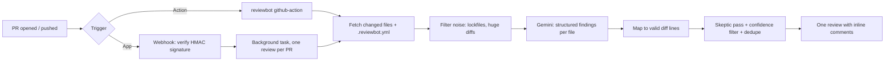

# reviewbot

[](https://github.com/ironhide554/Diffsage/actions/workflows/ci.yml)


An AI pull request reviewer that leaves **inline comments with one-click *Commit suggestion* fixes**.
Powered by Google Gemini, so it runs on the free tier.

| Use it as | Best for | Needs |
|---|---|---|
| [**GitHub Action**](#run-it-as-a-github-action-no-server-no-github-app) | Quickest install | One workflow file and a `GEMINI_API_KEY` secret |
| [**GitHub App**](#run-it-as-a-github-app) | Fork PRs, many repos | A server to host (Docker image included) |
| [**CLI**](#quick-start-cli) | Reviewing before you push | Python and a Gemini key |

## What a review looks like

On a PR that adds a file with four deliberate bugs, the bot posted this (from a real run on this repo):

```text
## 🤖 Automated review
Adds examples/user_lookup.py with SQL injection, shell injection, a hardcoded key and an off-by-one slice.
Risk: 🔴 high
Reviewed 1 file(s); posted 4 comment(s).

examples/user_lookup.py:6   🔒 Security: Hardcoded API keys in source can be compromised if the code is exposed.
examples/user_lookup.py:10  🔒 Security: The query is built by concatenating `name`; use a parameterized query.
examples/user_lookup.py:15  🔒 Security: shell=True with user input allows command injection.
examples/user_lookup.py:19  🐛 Bug: the slice is off by one and drops an element.
```

After a follow-up push the bot added nothing new: no repeated comments and no second summary.
Comment wording is paraphrased; the lines and findings are what the live run reported.

## Why it's not another "paste code into an LLM" demo

| Problem with naive AI reviewers | What reviewbot does |
|---|---|
| Comments on lines GitHub rejects | Parses diff hunks and only attaches to valid lines, snapping near misses ([`diffparse.py`](src/reviewbot/diffparse.py)) |
| Noisy, low-value nitpicks | Confidence threshold, severity filter (nits off by default), hard comment cap |
| False positives | Two-pass review: a second "skeptic" call must confirm each finding |
| Repeats itself on every push | Each comment carries a hidden fingerprint of *the flagged code* (not the model's wording, which changes every run); a finding on or next to an already-reported line is skipped |
| Wrong "fix this" buttons | A suggestion is offered only when replacing that one line fully fixes the problem |
| Summary says "low risk" on a vulnerable PR | The shown risk is raised to match the findings actually posted |
| Prompt injection via the diff | Diff and PR text are treated as data; the model has no tools to act on them |
| Free-tier rate limits | Client-side throttle shared across reviews, exponential backoff, sequential file review |
| "Trust me, it works" | [`eval/`](eval) scores precision and recall on labeled cases |

## How it works



## Quick start (CLI)

```bash
git clone https://github.com/ironhide554/Diffsage.git && cd Diffsage
python -m venv .venv && source .venv/bin/activate     # Windows: .venv\Scripts\activate
pip install -e ".[dev]"
cp .env.example .env            # add GEMINI_API_KEY from https://aistudio.google.com/apikey
# .env is loaded automatically (works the same on Windows, macOS and Linux)

cd /path/to/any/git/repo
reviewbot review --base main
```

Useful flags: `--staged` (only staged changes), `--title "PR title"` (extra context), and
`--fail-on-findings` (exit 1 if anything is found, handy in a pre-push hook).

## Run it as a GitHub Action (no server, no GitHub App)

The easiest install: add a workflow to the repo you want reviewed and a `GEMINI_API_KEY` repository secret
(Settings → Secrets and variables → Actions).

```yaml
# .github/workflows/review.yml
name: AI review
on:
  pull_request:
    types: [opened, synchronize, reopened, ready_for_review]

permissions:
  contents: read
  pull-requests: write

concurrency:
  group: review-${{ github.event.pull_request.number }}
  cancel-in-progress: true

jobs:
  review:
    runs-on: ubuntu-latest
    steps:
      - uses: ironhide554/Diffsage@main
        with:
          gemini-api-key: ${{ secrets.GEMINI_API_KEY }}
```

Comments are posted as `github-actions[bot]`. Dedupe, the skeptic pass, and `.reviewbot.yml` work exactly as in the
App.

- **Fork PRs:** GitHub gives workflows a read-only token and no secrets for pull requests from forks, so the
  action cannot review those. Use the GitHub App for public repos that take outside contributions.
- **Private action repo:** if Diffsage itself is private, other repositories can only use it after you allow
  access under the Diffsage repo's Settings → Actions → General → Access. Making it public avoids this.

This repository reviews its own pull requests with [`review.yml`](.github/workflows/review.yml).

## Run it as a GitHub App

1. GitHub → Settings → Developer settings → **GitHub Apps → New GitHub App**.
2. Permissions: **Pull requests: Read & write**, **Contents: Read-only**, **Metadata: Read-only**.
3. Subscribe to the **Pull request** event. Set a webhook secret and generate a private key (`.pem`).
4. Put `GITHUB_APP_ID`, `GITHUB_WEBHOOK_SECRET`, `GITHUB_PRIVATE_KEY_PATH` and `GEMINI_API_KEY` in `.env`.
5. Start the server and expose it:

```bash
uvicorn reviewbot.app:app --port 8000
npx smee-client --url https://smee.io/<your-channel> --target http://localhost:8000/webhook   # local dev
```

6. Set the app's webhook URL to your smee channel (dev) or deployed URL (prod), install the app on a repo, open a PR.

Deploy anywhere that runs a container or Python process (Fly.io, Railway, Render, Cloud Run). The webhook
returns immediately and reviews run in the background, so GitHub's 10-second timeout is never an issue.
A [`Dockerfile`](Dockerfile) is included:

```bash
docker build -t reviewbot .
docker run -p 8000:8000 --env-file .env reviewbot
```

For `GITHUB_PRIVATE_KEY`, paste the PEM with literal `\n` sequences (or mount the file and set
`GITHUB_PRIVATE_KEY_PATH`). Run **one replica only**, since the per-PR lock lives in memory.
`GET /healthz` is available for health checks.

## Configuration

Drop a [`.reviewbot.yml`](.reviewbot.yml) in the root of the repo being reviewed. Every key is optional.

| Key | Default | Meaning |
|---|---|---|
| `min_confidence` | `0.7` | Drop findings the model is less sure about (0 to 1) |
| `max_comments` | `10` | Cap on inline comments per review (1 to 50) |
| `severities` | security, bug, performance, maintainability | Add `nit` to enable style comments |
| `verify` | `true` | Second "skeptic" pass that discards false positives |
| `ignore` | none | Extra glob patterns to skip (added to the built-in list) |
| `ignore_defaults` | `true` | Set `false` to drop the built-in ignores (lockfiles, images, `dist/*`, ...) |
| `instructions` | empty | Repo-specific guidance for the reviewer (max 2000 characters) |

Environment variables: `GEMINI_API_KEY`, `GEMINI_MODEL` (default `gemini-3.5-flash-lite`), and `GEMINI_RPM`
(requests per minute, default `12`, under the 15 the default model allows on the free tier).

## Evaluation

```bash
python eval/score.py
```

Seven labeled cases live in `eval/cases/` (4 real-bug patches, 3 clean diffs that measure false alarms). Add real buggy
commits from open-source projects as more JSON files to make the numbers meaningful.

| Model | Cases | Precision | Recall | Notes |
|---|---|---|---|---|
| gemini-3.5-flash-lite | 7 | 100% | 100% | Current prompt (measured 2026-10-10) |
| gemini-2.5-flash | 7 | 100% | 100% | Earlier prompt, before the suggestion tweak |

The cases are small and synthetic, so treat this as a smoke test, not a benchmark.

## Development

```bash
pytest -q       # 54 offline tests (no API key or network needed)
ruff check .
```

```text
src/reviewbot/
  diffparse.py   parse unified diffs, map findings to valid lines
  reviewer.py    LLM pass, filtering, skeptic pass, ranking, fingerprints, rendering
  service.py     review one PR end to end; per-PR lock; fallback on 422
  github.py      GitHub client (App JWT or plain token)
  llm.py         Gemini wrapper: structured output, throttle, retries
  app.py         FastAPI webhook server (GitHub App)
  cli.py         `reviewbot review` and `reviewbot github-action`
  config.py      .reviewbot.yml parsing
```

## Known limitations

- Fork PRs can't be reviewed by the Action (see above); use the App.
- Suggestions only cover single-line fixes; larger fixes are described in the comment text.
- Two different same-severity issues on adjacent lines can be merged into one comment.
- The Gemini free tier has daily caps, and each reviewed file costs up to two calls. Google does not publish
  per-model numbers in its docs; they appear only on your own
  [AI Studio rate-limit page](https://aistudio.google.com/rate-limit). Observed on 2026-10-10 (one project):

  | Model | Requests/min | Requests/day |
  |---|---|---|
  | `gemini-3.5-flash-lite` (default) | 15 | 500 |
  | `gemini-3.1-flash-lite` | 15 | 500 |
  | `gemini-3.8-flash`, `gemini-3.6-flash`, `gemini-3-flash`, `gemini-2.5-flash` | 5 | 20 |

  At 500 requests a day that is roughly 250 reviewed files. When the cap is hit the run stops with a clear
  "daily quota" message and posts nothing. Set `GEMINI_MODEL` (or the Action's `gemini-model` input) to switch
  models, lower `GEMINI_RPM` to 4 for the 5-per-minute models, or use a paid key. Limits change, so re-check.
- A large PR is slow on the free tier: at the default 12 requests per minute, each file costs up to two
  calls, and at most 25 files are reviewed per PR.
- Only the diff is sent to the model, not the full source of each file.

## Roadmap

- [ ] `@reviewbot explain` / `@reviewbot fix` replies to comments
- [ ] Persist fingerprints and review stats in SQLite and add a small dashboard
- [ ] Per-file full-source context, not just the diff
- [x] Publish as a GitHub Action for zero-hosting installs

## Privacy

Code is sent to the Gemini API for analysis and is not stored by this app. Note that on Google's free tier,
prompts may be used to improve their products, so avoid enabling the bot on private or sensitive repositories
until you move to a paid key.

## License

MIT
